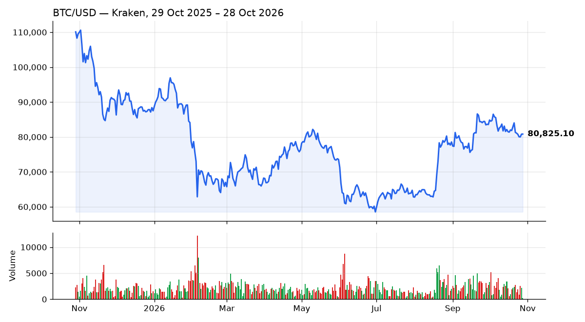

# kraken-tracker

[](https://github.com/born2feel/kraken-tracker/actions/workflows/ci.yml)
[](https://github.com/born2feel/kraken-tracker/actions/workflows/update.yml)


A command-line tool that pulls crypto market data from the
[Kraken exchange public API](https://docs.kraken.com/api/docs/rest-api/get-ticker-information),
stores daily candles in CSV and draws charts. A scheduled GitHub Actions job updates
the dataset in [`data/`](data) every day, so the chart below is always fresh.



## Features

- Live prices for any Kraken pair: last price, change since 00:00 UTC, 24h range and volume
- OHLC candles from 1 minute to 15 days
- Incremental CSV storage keyed by (pair, time): no duplicates, safe to re-run
- Price + volume charts, from the API or from the collected data
- Retries with exponential backoff on rate limits, 5xx errors and network failures
- Daily auto-update via GitHub Actions
- 40 tests that never touch the network, CI on Python 3.11–3.13, linting with ruff

## Quick start

```bash
git clone https://github.com/born2feel/kraken-tracker.git
cd kraken-tracker
python -m venv .venv
source .venv/bin/activate   # Windows: .venv\Scripts\activate
pip install -e .
```

No API key is needed: market data endpoints are public.

## Usage

```bash
python -m kraken_tracker price BTC/USD ETH/USD doge-usd
```

```
PAIR                 LAST    TODAY        24H LOW       24H HIGH          24H VOL
BTC/USD         81,442.80   -0.07%      80,705.40      82,376.20         1,565.02
ETH/USD          2,428.50   +0.34%       2,390.35       2,477.22        28,180.35
DOGE/USD         0.080007   -0.99%       0.079263       0.082310    24,746,980.53
```

```bash
python -m kraken_tracker history ETH/USD --interval 4h --limit 3
```

```
TIME (UTC)                OPEN         HIGH          LOW        CLOSE         VOLUME
2026-10-17 04:00     2,424.15     2,434.70     2,421.89     2,431.40       1,645.13
2026-10-17 08:00     2,431.41     2,438.00     2,429.85     2,430.77       1,440.66
2026-10-17 12:00     2,430.77     2,431.77     2,427.84     2,428.50          47.57  (open)
```

```bash
# Save up to 720 daily candles per pair to data/daily.csv
python -m kraken_tracker update --pairs BTC/USD,ETH/USD,SOL/USD

# Chart for the last year from collected data (or omit --from-csv to use the API)
python -m kraken_tracker plot BTC/USD --from-csv data/daily.csv --days 365 -o btc.png
```

After `pip install -e .`, the same commands are available as `kraken-tracker <command>`.

## How it works

```
kraken_tracker/
├── client.py    HTTP requests, retries with backoff, error context
├── parser.py    JSON → typed objects, API error handling
├── pairs.py     "btc-usd" → "BTCUSD", supported intervals
├── models.py    Ticker / Candle dataclasses with Decimal values
├── storage.py   CSV merge keyed by (pair, time)
├── chart.py     matplotlib price + volume chart
└── cli.py       argparse commands
```

Things the Kraken API does that the code handles:

- **Errors come with HTTP 200.** Every response is `{"error": [...], "result": {...}}`, so the
  error list is checked on every call. Rate-limit errors are retried, others fail fast with the
  pair name in the message.
- **Pairs are renamed in responses.** Asking for `BTCUSD` returns data under `XXBTZUSD`,
  `DOGEUSD` under `XDGUSD`. The parser takes the single pair in the result instead of
  guessing Kraken's legacy names.
- **The last candle is still open.** The `last` field marks the newest closed candle. Open
  candles are flagged, and because storage is keyed by (pair, time), the next run overwrites
  them with final values.
- **Prices are strings.** They are parsed into `Decimal`, never `float`, so no precision is lost.

## Development

```bash
pip install -e ".[dev]"
pytest
ruff check . && ruff format --check .
```

Tests use responses recorded from the real API and a fake HTTP session, which also makes
it easy to test retries, timeouts and malformed data.

## License

[MIT](LICENSE)
